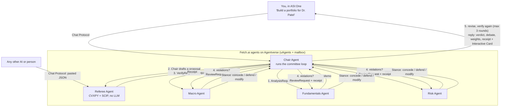
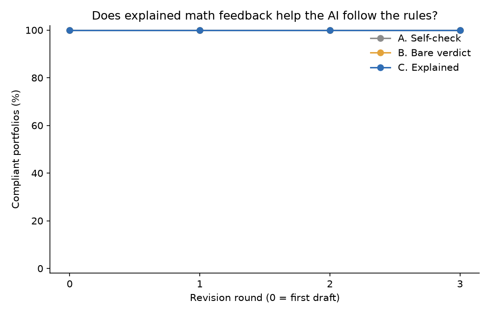

# SwarmFolio Referee

**AI proposes. Math decides.**

SwarmFolio Referee is an autonomous investment committee. Three AI analysts and an AI Chair draft a portfolio for a client, and a deterministic **Referee** checks it against the client's rules with an exact optimization solver (CVXPY + SCIP). When rules are broken, the Referee says which ones and by how much, and repairs the portfolio with the fewest possible changes. When the rules themselves are impossible, it proves that, names the rules that clash, and prices the cheapest fix. Every answer comes with an auditable receipt. The committee runs as **five Fetch.ai agents** on Agentverse, and you can talk to it in **ASI:One**.

> Built at **LA Hacks 2026** for the Applied Intelligence and Agentverse tracks and the Fetch.ai ASI:One Agent Challenge.

---

## Live links

| What | Link |
|---|---|
| Chair Agent (Agentverse profile) | `TODO: https://agentverse.ai/agents/details/<chair-address>` |
| Referee Agent (Agentverse profile) | `TODO` |
| Macro Agent | `TODO` |
| Fundamentals Agent | `TODO` |
| Risk Agent | `TODO` |
| Chat with the committee in ASI:One | `TODO: https://asi1.ai/...` |
| Demo video | `TODO` |
| Devpost | `TODO` |

---

## The problem

Advisors increasingly let AI draft portfolios, and the drafts break client rules. In the BiasMix-Finance study (ICLR 2026 workshop), **47.6–85.7% of AI first drafts** violated the client's constraints. A portfolio that puts 41% in one stock when the client said "no single position above 35%" can't legally go out: advisors are fiduciaries, and FINRA's 2026 regulatory oversight report expects firms using generative AI to have **guardrails and audit trails**.

Writing the rules into the prompt doesn't fix this. A prompt is a suggestion, and nothing checks whether the model followed it.

## The solution

Separate the creative part from the part that has to be right:

- **AI agents propose.** Macro, Fundamentals and Risk analysts write memos, and the Chair turns them into a portfolio.
- **The Referee decides.** It checks the portfolio against every rule, finds out whether the rules can be met at all, explains what clashes, computes the cheapest fix, repairs the portfolio and writes a receipt.
- **The AI learns from the math.** The analysts read the receipt and **concede, defend or modify**, and the Chair revises. The loop runs for up to 3 rounds, and you can see who changed their mind.

### Why the Referee is exact math, not an LLM or PSO

A verifier has to give the same answer every time, and it has to be able to **prove** that no valid portfolio exists.

- **An LLM** is creative but can't guarantee either property. Asking it to check its own work is what most AI products do today, and it's the baseline we test against.
- **PSO** (particle swarm optimization, which the original SwarmFolio project used) is a random search. If it doesn't find a portfolio, all it can say is "didn't find one", not "none exists". The old SwarmFolio swarm check actually called a feasible rule set impossible.
- **A mixed-integer convex program** (CVXPY, solved by SCIP) is exact: infeasible means infeasible, and the same input always gives the same receipt id.

PSO searches; the exact solver judges.

---

## Architecture



**The loop** (`committee/loop.py`, `run_committee`):
1. All 3 analysts write memos.
2. The Chair proposes weights.
3. The Referee verifies them.
4. If rules broke, each analyst reads the receipt and takes a stance, and the Chair revises.
5. Steps 3–4 repeat for up to `MAX_ROUNDS = 3`.

The result holds the final portfolio, the receipt, the first receipt, and a debate log of every stance.

### Brains vs. phones

The project has two layers, so the agent network can never be a single point of failure:

1. **Brains:** plain Python functions (`referee/`, `committee/`). The analysts, the Chair, the Referee and the feedback loop pass JSON-validated Pydantic models to each other and work with **no Fetch at all**. The web app and the evaluation run on this layer.
2. **Phones:** thin uAgents wrappers (`agents/`). Each one receives a message, calls the brain with `asyncio.to_thread`, wraps the result and sends it back. Agent files contain no business logic.

The loop takes a **transport**:
- `LocalTransport` calls the brains directly.
- `AgentTransport` sends Fetch messages: `ctx.send_and_receive` with JSON envelopes from `agents/messages.py`.

The same `run_committee` works with both.

**Reliability (Fetch bonus criterion):**
- **Referee calls** wait `AGENT_TIMEOUT_S` (45 s) and retry once. If the Referee agent stays silent, the Chair runs the local Referee, so verification is never skipped.
- **Analyst calls** wait `ANALYST_TIMEOUT_S` (240 s, because LLMs are slow). All 3 analysts are asked at once.
  - A timeout doesn't trigger a retry, since the analyst is still thinking.
  - An error reply or a failed send gets one retry.
  - An analyst that still doesn't answer is skipped, and the reply says so.
- **Any exception** in an agent handler becomes an `ErrorMsg`, not a crash.

**ASI:One Interactive Cards (Fetch bonus criterion):** besides the plain-text answer, the Chair and the Referee attach cards (`agents/cards.py`):
- a **receipt card** with the verdict, each failed rule's actual value vs. its limit in the client's words, the conflict and cheapest fix, and the holdings before and after repair;
- a **client picker** with a "Build portfolio" button on each client;
- a **price-tag card**.

| Agent | Handles | Calls |
|---|---|---|
| **Chair** (port 8001) | Chat Protocol: "list clients", "Build a portfolio for C02", "price tags for C02" | `run_committee(client, AgentTransport)` |
| **Referee** (8002) | `VerifyRequest`; also Chat Protocol (pasted JSON) from anyone | `referee(client, proposal)` |
| **Macro** (8003), **Fundamentals** (8004), **Risk** (8005) | `AnalysisRequest` → `Memo`, `ReviewRequest` → `Stance` | `analyze(role, …)`, `review(role, …)` |

The analyst and Chair brains are built with **LangChain** (`committee/llm.py`). The default model is Fetch's **ASI:One**, and Gemini or Anthropic can be switched in with `LLM_PROVIDER`. Every response is validated with Pydantic, retried once with the validation error if invalid, and cached on disk, so reruns are free and reproducible.

---

## What the Referee does

`referee(client, proposal) -> Receipt` (`referee/receipt.py`) works on a client's rules (10 rule types: single-name caps and floors, exclusions, sector caps and floors, max/min holdings, a minimum position size, a volatility cap and a turnover cap).

```
check  →  feasible?  ──yes──→  all pass? → PASS
                │                    └─no→ repair → VIOLATIONS_REPAIRED
                └─no──→ minimal conflict set → cheapest fix → repair under the fix → RULES_INFEASIBLE
                                                                     ↓
                                                     receipt (id = sha256 of client + proposal)
```

| Step | What it does | Math |
|---|---|---|
| **Check** (`check.py`) | Actual vs. limit for every rule, with a plain-English sentence quoting the client | arithmetic, no solver |
| **Feasible?** (`solver.py`) | Can *any* portfolio meet all the rules? | MIP with binary "held" variables z ∈ {0,1}ⁿ, wᵢ ≤ zᵢ; volatility as a second-order cone ‖Lᵀw‖₂ ≤ σ_max |
| **Which rules clash?** (`conflicts.py`) | Smallest set of rules that can't hold together | deletion filter: drop each rule in turn and keep it only if dropping it makes the problem feasible. What's left is minimal |
| **Cheapest fix** (`relax.py`) | The cheapest loosening that makes the rules possible | elastic program: minimize Σ priority × slack (in percentage points or names). Hard rules are never relaxed |
| **Repair** (`repair.py`) | Nearest compliant portfolio | minimize ½‖w − p‖₁ (capital moved) subject to all the rules |
| **Receipt** (`receipt.py`) | Verdict, checks, conflict, fix, repaired weights, capital moved, Sharpe before and after, volatility, receipt id | deterministic and reproducible |

### Verified example: Dr. Patel (synthetic client C02)

She's a retired surgeon who wants growth but no fossil fuels and holds legacy JNJ stock from her career. Her 7 rules: no position above 35%, no XOM/CVX, keep at least 30% in JNJ, Healthcare at most 35%, at most 8 holdings, no position under 5%, and annual volatility at most 18%.

An AI proposes **NVDA 41%, JNJ 30%, GOOGL 15%, XOM 14%**. The Referee replies (output from the current code and price data):

> **VIOLATIONS_REPAIRED.** The proposal broke 3 of 7 rules. The nearest compliant portfolio moves 20% of capital and changes Sharpe from 1.73 to 1.87.
> - The largest position is NVDA at 41.0% (limit 35.0%): BROKEN. The client said: 'No single position above 35%.'
> - The portfolio holds XOM (14.0% in total) (limit 0.0%): BROKEN. The client said: 'No fossil fuel companies.'
> - Annual volatility is 20.8% (limit 18.0%): BROKEN. The client said: 'Annual volatility at most 18%.'
>
> Repaired: **NVDA 35.0%, JNJ 30.3%, KO 19.5%, GOOGL 15.2%**, volatility 18.0% (right on the cap).

Now add the rule *"Hold at least 10% UNH (family shares)"* (client C03). The Referee proves that no portfolio exists:

> **RULES_INFEASIBLE.** These rules can't all hold: 'Keep at least 30% in legacy JNJ (tax reasons)', 'Healthcare at most 35%', 'Hold at least 10% UNH (family shares)' (30% + 10% = 40% > 35%).
> Cheapest fix: Raise 'Healthcare at most 35%' from 35.0% to 40.0% (cost 4 x 5 points = 20).

Most systems would silently drift away from one of these rules. The Referee tells the advisor why and asks which rule to loosen. Both cases are integration tests in `tests/test_patel.py`.

### Rule price tags

Clients never get to see what a rule *costs*; institutional tools sell this as "constraint attribution". `referee/prices.py`:
1. Finds the best risk-adjusted portfolio under all the rules: maximize U(w) = μᵀw − (γ/2)·wᵀΣw, with γ = 3.
2. Re-solves without each rule. The improvement is that rule's exact price.
3. Removing a rule can only help, so a price is never negative. A rule with zero cost "doesn't bind".

For Dr. Patel:

| Rule (her words) | Cost per year | Sharpe with → without |
|---|---|---|
| "Keep at least 30% in legacy JNJ (tax reasons)." | **0.85 points** of risk-adjusted return | 1.95 → 2.00 |
| "Annual volatility at most 18%." | **0.70 points** | 1.95 → 1.79 (it takes more risk) |
| The other 5 rules | nothing: they never bind | 1.95 → 1.95 |

---

## The feedback experiment

**Question:** can math feedback teach an AI to follow a client's rules, and does it matter whether the math *explains* itself? (`eval/experiment.py`)

**Design (this run):** the comparison is paired, so it's fair.
- **Clients:** the 4 hard clients C91–C94. These are realistic, tight clients: their limits sit just above the solver's floor, the tightest limit any portfolio could meet. The AI has to calculate whether a portfolio fits, not just read the rules. (Infeasible clients can't comply, so they're judged separately.)
- **Trials:** 3 per client, so 12 client-trials, with model `asi1`. The trial number goes into the prompt, and calls use temperature 0.7, so each trial is a genuinely different sample.
- **Shared start:** per client-trial, the 3 memos and the Chair's **first draft** are made once and reused, so every condition starts from exactly the same draft.

There are three conditions. Each one gets up to 3 rounds of Chair-only revision, with the Referee checking after every round:

| Condition | What the Chair is told each round |
|---|---|
| **A. Self-check** | "Re-check your portfolio against the client's rules and fix anything that breaks them." (What most AI products do today.) |
| **B. Bare verdict** | Which rules failed: ids and the client's wording, with no numbers |
| **C. Explained** | The Referee's sentences (actual vs. limit) and the conflict explanation. **Never** the repaired weights |

**Metrics** for each condition at rounds 0–3:
- compliance rate;
- mean number of broken rules and mean total violation;
- capital moved from the first draft (how much of the AI's idea is kept);
- 95% bootstrap confidence intervals;
- paired sign tests for C vs. B and C vs. A.

A larger run on the 15 generated feasible clients (C10–C24) with `asi1-mini` is in progress.

### Results (C91–C94 × 3 trials = 12 client-trials, `asi1`)

**10 of 12 first drafts (83%) broke at least one rule.**

| Condition | Compliant after 3 rounds [95% CI] |
|---|---|
| A. Self-check | 33% [8, 58] |
| B. Bare verdict | 42% [17, 67] |
| C. Explained | 50% [25, 75] |

Paired sign tests compare how many rounds each client-trial needed to become compliant:

| Comparison | C fewer / same / more | p |
|---|---|---|
| C vs. B | 2 / 9 / 1 | 1.000 |
| C vs. A | 3 / 8 / 1 | 0.625 |



**Finding:** on realistic, tight clients, the AI broke a rule in 83% of first drafts.
- More explanation helped: compliance after 3 rounds went from 33% to 42% to 50%. With 12 trials the difference is **not statistically significant**, so it's a trend, not a proof.
- Even with the best feedback, half the portfolios still broke a rule after 3 tries. Only the Referee's repair reached 100% compliance.

Full tables, including broken-rule counts and capital moved, are in `eval/results/experiment.md`.

The evaluation (`eval/run_eval.py`, metrics M1–M6) judges the infeasible clients separately. C03, C25, C26 and C27 each have a planted conflict, and M5 checks that the Referee flags each one as impossible and returns exactly the planted conflict set.

---

## How to run

Requires Python 3.10+ (developed for 3.14). From the repo root:

```bash
python -m venv .venv && source .venv/bin/activate
pip install -r requirements.txt          # includes cvxpy + pyscipopt (the SCIP solver)
cp .env.example .env                     # then fill in what you need (below)
```

### 1. The Referee only (no API keys)

```python
import json
from referee.receipt import referee
from referee.prices import rule_prices
from referee.schema import Client, Proposal

client = Client(**json.load(open("data/clients/C02.json")))
weights = {"NVDA": 0.41, "JNJ": 0.30, "GOOGL": 0.15, "XOM": 0.14}
receipt = referee(client, Proposal(weights=weights, thesis="demo", reasons={t: "" for t in weights}))
print(receipt.verdict, receipt.summary)
for p in rule_prices(client):
    print(p.explain)
```

To refresh prices to today, run `python data/refresh_data.py` (it uses yfinance). The bundled `data/prices.csv` from SwarmFolio is the fallback.

### 2. The five Fetch agents

In `.env`, set:
- `ASI1_API_KEY`, or another provider's key plus `LLM_PROVIDER`;
- 5 stable seed phrases: `CHAIR_SEED`, `REFEREE_SEED`, `MACRO_SEED`, `FUNDAMENTALS_SEED`, `RISK_SEED`;
- `USE_ANALYST_AGENTS=true`, to route memos and stances through the analyst agents.

Without the flag, the Chair calls the analyst brains locally. The Referee always goes over the network, with a local fallback.

```bash
python -m agents.run_all      # starts Referee, Macro, Fundamentals, Risk, Chair on ports 8001–8005
```

It prints each agent's address and **Inspector** link. For each agent:
1. Open its Inspector link → **Connect** → **Mailbox**.
2. Wait for "Successfully registered as mailbox agent in Agentverse" in the log.
3. Edit the agent's Agentverse profile (name, handle, description).

Then chat with the Chair in ASI:One:
- `list clients`
- `Build a portfolio for Dr. Patel`
- `price tags for C02`

To start a single agent, use `python -m agents.referee_agent` (or `chair_agent`, `macro_agent`, …).

### 3. The web app (FastAPI + React)

```bash
uvicorn api:app --reload --port 8000                 # API (repo root, inside .venv)
cd frontend && npm install && npm run dev            # http://localhost:5173, proxies /api -> :8000
```

- The app has three pages: client picker, run view, and the experiment.
- It replays saved committee runs from `data/demo_runs/`. Live runs take minutes. Regenerate them with `python data/demo_runs/save_demo_run.py C02 C91`, which needs `ASI1_API_KEY`.
- `POST /referee` and `GET /prices/{id}` call the real Referee live.
- After `npm run build`, `uvicorn api:app` serves the whole app on one port.

### 4. Tests

```bash
pytest           # Referee math, the Dr. Patel example, generated clients, agents (offline), cards, eval
```

---

## Built at LA Hacks vs. before

| Pre-existing (open source, MIT) | Built at LA Hacks (what gets judged) |
|---|---|
| SwarmFolio: the price-download code and cached prices for 19 stocks, return and covariance math, a PSO optimizer, a backtest | Rule schema (10 rule types), the Referee (exact solver, conflict finder, cheapest relaxation, repair, receipt, rule price tags), the analyst and Chair logic, the feedback loop, the 5 Fetch agents and their messages, ASI:One Interactive Cards, the synthetic clients, the evaluation and feedback experiment, the web app (FastAPI + React; designed in Paper: **TODO-confirm**) |

*Design notes were written before the event; all code was written during it.* The commit history shows the build step by step.

All clients are synthetic. This is a tool for advisors: the Referee only checks rules, and humans decide. It is not investment advice.

## Credits

- **SwarmFolio** (MIT, Samarth Mukhi): the original portfolio project this builds on (price data, return/covariance math, PSO)
- **[Fetch.ai uAgents](https://github.com/fetchai/uAgents)**, Agentverse and ASI:One: the agent framework, registry and chat
- **[CVXPY](https://www.cvxpy.org/)**: the convex optimization modeling layer
- **[SCIP](https://www.scipopt.org/)** (via PySCIPOpt): the mixed-integer solver behind every Referee answer
- **[LangChain](https://www.langchain.com/)**: the LLM layer for the analysts and the Chair
